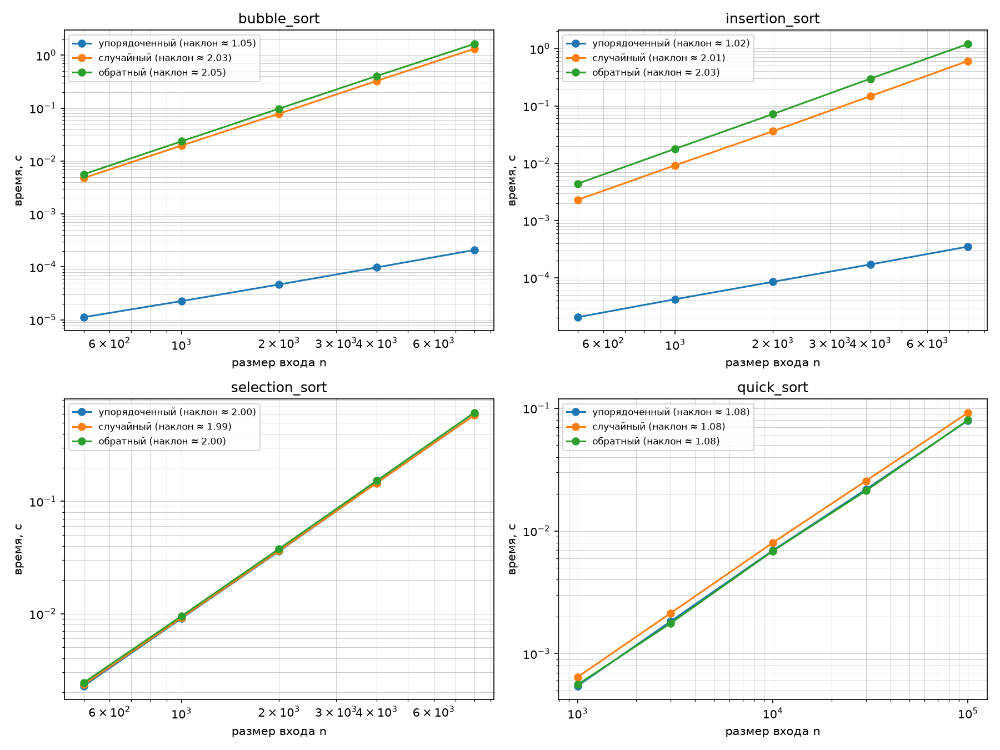

# Лабораторная работа 3 «Экспериментальное сравнение простых сортировок; QuickSort с рандомизацией опорного элемента»

## Цель работы

Освоить простые сортировки и QuickSort, экспериментально подтвердить их асимптотику на разных классах входов и понять роль стабильности и рандомизации опорного элемента.

---

# Задание

## 1. Реализовать сортировки пузырьком, вставками и выбором со счётчиками сравнений и обменов (перемещений); счётчики выводятся вместе с результатом

### 1.1. Сортировка пузырьком (Bubble Sort)

Сортировка пузырьком последовательно сравнивает соседние элементы массива. Если элементы стоят в неправильном порядке, они меняются местами. После каждого прохода наибольший из оставшихся элементов перемещается в конец массива.

В реализации используется проверка, произошёл ли хотя бы один обмен за проход. Если массив уже упорядочен и обмены не потребовались, алгоритм завершает работу досрочно.

Это позволяет сократить время работы на уже отсортированных данных.

```python
def bubble_sort(a: list) -> tuple[list, int, int]:
    copy = list(a)
    comp = swaps = 0
    n = len(copy)

    for i in range(n):
        swapped = False
        for j in range(n - 1 - i):
            comp += 1
            if copy[j] > copy[j + 1]:
                copy[j], copy[j + 1] = copy[j + 1], copy[j]
                swaps += 1
                swapped = True

        if not swapped:
            break

    return copy, comp, swaps
```

`copy` — копия исходного массива, `comp` — количество сравнений, `swaps` — количество обменов. Переменная `swapped` позволяет определить, нужно ли продолжать сортировку.

Сложность алгоритма: худший и средний случай O(n^2) (обратный/случайный вход - полный перебор без досрочного выхода, n(n-1)/2 сравнений). Лучший случай O(n) на уже отсортированном входе - досрочный выход, если за проход не было ни одного обмена, останавливает алгоритм после первого же прохода (n-1 сравнений).

### 1.2. Сортировка вставками (Insertion Sort)

Сортировка вставками постепенно строит отсортированную часть массива. На каждой итерации очередной элемент сравнивается с элементами слева и перемещается в подходящую позицию.

Если элемент больше предыдущего, он сдвигается вправо. Процесс продолжается до тех пор, пока не будет найдено место для вставки.

Для уже отсортированного массива количество сравнений минимально, поскольку элементы не требуется перемещать.

```python
def insertion_sort(a: list) -> tuple[list, int, int]:
    copy = list(a)
    comp = moves = 0

    for i in range(1, len(copy)):
        key = copy[i]
        j = i - 1

        while j >= 0 and copy[j] > key:
            comp += 1
            copy[j + 1] = copy[j]
            moves += 1
            j -= 1

        if j >= 0:
            comp += 1

        copy[j + 1] = key

    return copy, comp, moves
```

Переменная `key` хранит элемент, который необходимо вставить. Внутренний цикл сдвигает большие элементы вправо, освобождая для него место. Счётчик `moves` увеличивается при каждом таком сдвиге.

Сложность алгоритма: худший случай O(n^2) (обратный вход - каждый новый элемент сдвигается через весь уже отсортированный префикс). Лучший случай O(n) на уже отсортированном входе - внутренний while сразу завершается без единого сдвига, остаётся n-1 сравнений.

### 1.3. Сортировка выбором (Selection Sort)

Сортировка выбором на каждом шаге ищет минимальный элемент в неотсортированной части массива. После нахождения минимума он меняется местами с первым элементом этой части.

Затем область поиска уменьшается, и процесс повторяется до тех пор, пока весь массив не будет упорядочен.

Количество сравнений практически не зависит от исходного порядка элементов, так как алгоритм каждый раз просматривает оставшуюся часть массива.

```python
def selection_sort(a: list) -> tuple[list, int, int]:
    copy = list(a)
    comp = swaps = 0
    n = len(copy)

    for i in range(n - 1):
        min_idx = i

        for j in range(i + 1, n):
            comp += 1
            if copy[j] < copy[min_idx]:
                min_idx = j

        if min_idx != i:
            copy[i], copy[min_idx] = copy[min_idx], copy[i]
            swaps += 1

    return copy, comp, swaps
```

Переменная `min_idx` хранит индекс минимального элемента в рассматриваемой части массива. После завершения внутреннего цикла найденный минимум перемещается на нужную позицию.

Сложность алгоритма — O(n^2) на любом входе. Чтобы найти минимум среди оставшихся элементов, внутренний цикл обязан просмотреть их все независимо от значений - число сравнений всегда n(n-1)/2, досрочного выхода не существует. Единственная переменная величина - число обменов (не больше n-1), но она не входит в число сравнений.

### 1.4. Результаты подсчёта операций

Для сравнения алгоритмов был выполнен запуск на массивах размером n = 20. Рассматривались три вида входных данных: упорядоченный, случайный и обратно упорядоченный массивы.

**Bubble Sort**

| Тип массива | Сравнения | Обмены |
|---|---:|---:|
| Упорядоченный | 19 | 0 |
| Случайный | 189 | 81 |
| Обратно упорядоченный | 190 | 190 |

На упорядоченном массиве алгоритм выполнил только 19 сравнений и не сделал ни одного обмена. Это объясняется досрочным завершением после первого прохода без обменов. 

**Insertion Sort**

| Тип массива | Сравнения | Перемещения |
|---|---:|---:|
| Упорядоченный | 19 | 0 |
| Случайный | 99 | 81 |
| Обратно упорядоченный | 190 | 190 |

На упорядоченном массиве сортировка вставками также выполнила минимальное количество сравнений.

**Selection Sort**

| Тип массива | Сравнения | Обмены |
|---|---:|---:|
| Упорядоченный | 190 | 0 |
| Случайный | 190 | 15 |
| Обратно упорядоченный | 190 | 10 |

Количество сравнений одинаково для всех типов входных данных. Количество обменов зависит от исходного порядка элементов.

Для вывода счётчиков была реализована отдельная функция, которая последовательно запускает три простые сортировки на каждом из трёх классов входных данных и выводит количество сравнений и обменов.

```python
def counters_demo(seed: int, n: int = 20) -> None:
    print(f"\nСчётчики операций (n={n}):")

    simple = {
        "bubble_sort": bubble_sort,
        "insertion_sort": insertion_sort,
        "selection_sort": selection_sort,
    }

    for name, fn in simple.items():
        print(f"  {name}:")
        for cls, data in make_inputs(n, seed).items():
            _, comp, swaps = fn(data)
            print(
                f"    вход={cls:<13} "
                f"сравнения={comp:>4} "
                f"обмены/перемещения={swaps:>4}"
            )
```

---

## 2. Реализовать QuickSort с рандомизированным выбором опорного элемента (`random.randrange`); рекурсию ограничить корректной обработкой малых подмассивов

Для выбора опорного элемента используется генератор случайных чисел `random.Random` и метод `randrange`.

Если длина массива не превышает единицу, рекурсивное разбиение не требуется: пустой массив и массив из одного элемента уже отсортированы.

В остальных случаях выбирается опорный элемент, после чего массив разделяется на три части:
- `less` — элементы меньше опорного;
- `equal` — элементы, равные опорному;
- `greater` — элементы больше опорного.

Затем левая и правая части рекурсивно сортируются, а результат формируется объединением трёх частей.

**Реализация:**

```python
def quick_sort(a: list, rng: random.Random | None = None) -> list:
    if rng is None:
        rng = random.Random()
    if len(a) <= 1:
        return list(a)
    pivot = a[rng.randrange(0, len(a))]
    less = [x for x in a if x < pivot]
    equal = [x for x in a if x == pivot]
    greater = [x for x in a if x > pivot]
    return quick_sort(less, rng) + equal + quick_sort(greater, rng)
```
Рандомизированный выбор опорного элемента помогает снизить вероятность систематически неудачных разбиений на определённых типах входных данных.

Сложность алгоритма: в среднем O(n log n) (случайный pivot в среднем делит массив на сбалансированные части, глубина рекурсии log n, на каждом уровне суммарно O(n) работы на фильтрацию). В худшем случае O(n^2) (если пивот каждый раз оказывается экстремальным (мин/макс) элементом, одна из частей пуста, а другая размера n-1).

---

## 3. Сгенерировать по варианту три класса входов — упорядоченный, случайный, обратно упорядоченный — не менее 5 размеров с геометрическим шагом и выполнить замеры по методике бенчмаркинга

Для каждого алгоритма рассматривались три класса массивов:
- **Упорядоченный** — элементы расположены по возрастанию.
- **Случайный** — элементы расположены в случайном порядке.
- **Обратно упорядоченный** — элементы расположены по убыванию.

Функция создания входных данных:

```python
def make_inputs(n: int, seed: int) -> dict[str, list[int]]:
    """Три класса входов размера n: упорядоченный, случайный, обратный."""
    rng = random.Random(seed + n)  # свой поток для каждого размера
    data = [rng.randint(-1_000_000, 1_000_000) for _ in range(n)]
    return {
        "упорядоченный": sorted(data),
        "случайный": data,
        "обратный": sorted(data, reverse=True),
    }
```

Сначала создаётся случайный массив заданного размера. Затем из него формируются упорядоченная и обратно упорядоченная версии. 

Время выполнения измерялось для нескольких размеров массива. Результаты использовались для построения графиков зависимости времени сортировки от размера входных данных.

В ходе эксперимента для Bubble Sort, Insertion Sort и Selection Sort использовались размеры массивов от 500 до 8000 элементов. Для Quick Sort исследовались массивы размером от 1000 до 100000 элементов.

Для измерения времени была реализована функция:

```python
SIZES_QUADRATIC = [500, 1_000, 2_000, 4_000, 8_000]     # для простых сортировок
SIZES_QUICK = [1_000, 3_000, 10_000, 30_000, 100_000]   # для QuickSort
REPEATS = 5

def bench(fn, data: list) -> float:
    """Медиана времени выполнения fn(копия data) по REPEATS запускам, с прогревом."""
    fn(list(data))  # прогрев — не учитывается
    times = []
    for _ in range(REPEATS):
        arg = list(data)  # свежая копия: сортировка не должна получать свой результат
        t0 = time.perf_counter()
        fn(arg)
        times.append(time.perf_counter() - t0)
    return statistics.median(times)
```

Перед измерениями выполняется один прогревочный запуск, который не учитывается в результатах. Затем алгоритм запускается пять раз на копиях исходного массива. Итоговым временем считается медиана полученных значений.

### Результаты

### Bubble Sort

| Размер массива (n) | Упорядоченный (с) | Случайный (с) | Обратный (с) |
|---:|---:|---:|---:|
| 500 | 0.000011 | 0.004780 | 0.005636 |
| 1000 | 0.000023 | 0.019590 | 0.023560 |
| 2000 | 0.000046 | 0.078462 | 0.097668 |
| 4000 | 0.000098 | 0.326500 | 0.404160 |
| 8000 | 0.000208 | 1.318464 | 1.631744 |

### Insertion Sort

| Размер массива (n) | Упорядоченный (с) | Случайный (с) | Обратный (с) |
|---:|---:|---:|---:|
| 500 | 0.000021 | 0.002289 | 0.004387 |
| 1000 | 0.000042 | 0.009193 | 0.017839 |
| 2000 | 0.000085 | 0.036039 | 0.072016 |
| 4000 | 0.000171 | 0.147878 | 0.298467 |
| 8000 | 0.000351 | 0.607793 | 1.204625 |

### Selection Sort

| Размер массива (n) | Упорядоченный (с) | Случайный (с) | Обратный (с) |
|---:|---:|---:|---:|
| 500 | 0.002274 | 0.002335 | 0.002434 |
| 1000 | 0.009074 | 0.009192 | 0.009512 |
| 2000 | 0.035936 | 0.036379 | 0.037786 |
| 4000 | 0.146263 | 0.145566 | 0.152598 |
| 8000 | 0.585804 | 0.585886 | 0.616130 |

### Quick Sort

| Размер массива (n) | Упорядоченный (с) | Случайный (с) | Обратный (с) |
|---:|---:|---:|---:|
| 1000 | 0.000545 | 0.000644 | 0.000559 |
| 3000 | 0.001833 | 0.002139 | 0.001767 |
| 10000 | 0.006914 | 0.008004 | 0.006847 |
| 30000 | 0.021770 | 0.025547 | 0.021222 |
| 100000 | 0.079415 | 0.091894 | 0.080055 |

---

## 4. Продемонстрировать стабильность/нестабильность алгоритмов на массиве пар «(ключ, метка)»

Стабильность сортировки означает, что элементы с одинаковыми ключами после сортировки сохраняют свой исходный взаимный порядок.

Для проверки использовался массив пар, в которых первое значение является ключом сортировки, а второе — меткой элемента:

`[(2, 'a'), (1, 'b'), (2, 'c'), (1, 'd')]`

После сортировки по ключу элементы с ключом 1 должны оказаться раньше элементов с ключом 2. Чтобы сортировки сравнивали только ключи, была создана специальная обёртка:

```python
class _ByKey:
    """Обёртка для сравнения пар только по ключу (p[0]), метка игнорируется."""
    __slots__ = ("pair",)

    def __init__(self, pair):
        self.pair = pair

    def __lt__(self, other):
        return self.pair[0] < other.pair[0]

    def __gt__(self, other):
        return self.pair[0] > other.pair[0]

    def __eq__(self, other):
        return self.pair[0] == other.pair[0]
```

Класс `_ByKey` переопределяет операции сравнения так, чтобы сравнивались только первые элементы пар — ключи. Метки при сравнении не учитываются.

Для проверки стабильности была написана функция stability_demo:

```python
def stability_demo() -> None:
    pairs = [
        (2, "a"),
        (1, "b"),
        (2, "c"),
        (1, "d")
    ]

    wrapped = [_ByKey(p) for p in pairs]

    algorithms = {
        "bubble_sort": lambda a: bubble_sort(a)[0],
        "insertion_sort": lambda a: insertion_sort(a)[0],
        "selection_sort": lambda a: selection_sort(a)[0],
        "quick_sort": lambda a: quick_sort(a, random.Random(0)),
    }

    print("\nДемонстрация стабильности:")
    for name, fn in algorithms.items():
        result = fn(list(wrapped))
        labels = [w.pair[1] for w in result]
        print(f"  {name}: порядок меток = {labels}")
```

###Результаты:

| Алгоритм | Результат |
|---|---|
| Bubble Sort | `['b', 'd', 'a', 'c']` |
| Insertion Sort | `['b', 'd', 'a', 'c']` |
| Selection Sort | `['b', 'd', 'c', 'a']` |
| Quick Sort | `['b', 'd', 'a', 'c']` |

Bubble Sort и Insertion Sort сохранили порядок меток внутри групп с одинаковыми ключами. Selection Sort изменил порядок меток `a` и `c`, поэтому в данной реализации он является нестабильным.

Реализованный Quick Sort также сохранил порядок равных ключей в данном примере. Это связано с тем, что элементы группируются в отдельную часть `equal` в исходном порядке, а затем эта часть добавляется в результат без перестановки.

---

## 5. Построить log-log графики времени от размера входа для всех алгоритмов и классов входов; сопоставить наклоны с O(n²) и O(n log n)

Для визуального сравнения алгоритмов были построены графики зависимости времени выполнения от размера массива в логарифмическом масштабе.

Графики позволяют сравнивать рост времени работы при увеличении размера входных данных. 

Для вычисления наклона использовалась функция:

```python
def log_log_slope(points: list[tuple[int, float]]) -> float:
    """Наклон прямой в осях (log n, log t) - оценка показателя степени."""
    xs = [math.log10(n) for n, _ in points]
    ys = [math.log10(t) for _, t in points]
    mx, my = sum(xs) / len(xs), sum(ys) / len(ys)
    return (sum((x - mx) * (y - my) for x, y in zip(xs, ys))
            / sum((x - mx) ** 2 for x in xs))
```

Функция переводит размеры массивов и время выполнения в логарифмическую шкалу, после чего вычисляет наклон прямой. Полученное значение используется для оценки роста времени работы алгоритма.

Для построения графиков использовалась библиотека Matplotlib:

```python
def plot_results(results: dict, out_dir: Path) -> None:
    """Log-log графики времени от размера входа - отдельный график на алгоритм."""
    try:
        import matplotlib
        matplotlib.use("Agg")
        import matplotlib.pyplot as plt
    except ImportError:
        print("\nmatplotlib не установлен - графики пропущены "
              "(pip install -r requirements.txt)")
        return

    fig, axes = plt.subplots(2, 2, figsize=(12, 9))
    for ax, name in zip(axes.flat, results):
        for cls, points in results[name].items():
            ns = [n for n, _ in points]
            ts = [t for _, t in points]
            ax.plot(ns, ts, marker="o",
                    label=f"{cls} (наклон ≈ {log_log_slope(points):.2f})")
        ax.set_xscale("log")
        ax.set_yscale("log")
        ax.set_xlabel("размер входа n")
        ax.set_ylabel("время, с")
        ax.set_title(name)
        ax.grid(True, which="both", linewidth=0.3)
        ax.legend(fontsize=8)
    fig.tight_layout()
    path = out_dir / "lab03_sorts.png"
    fig.savefig(path, dpi=150)
    print(f"\nГрафик сохранён: {path}")
```

Для каждого алгоритма создаётся отдельный график. По горизонтальной оси откладывается размер массива, по вертикальной — время выполнения. Обе оси имеют логарифмический масштаб.

| Алгоритм | Упорядоченный массив | Случайный массив | Обратно упорядоченный массив |
|---|---:|---:|---:|
| Bubble Sort | 1,06 | 2,02 | 2,05 |
| Insertion Sort | 1,03 | 2,00 | 2,02 |
| Selection Sort | 1,99 | 1,98 | 2,01 |
| Quick Sort | 1,08 | 1,09 | 1,07 |

Для Bubble Sort и Insertion Sort наблюдается существенная разница между упорядоченными и остальными входными данными. Selection Sort демонстрирует квадратичный рост во всех случаях. Quick Sort показывает более медленный рост времени выполнения на исследованных размерах массивов.



**Рисунок 1 — Экспериментальная зависимость времени выполнения алгоритмов сортировки от размера входного массива.**

---

## 6. Верифицировать реализации: проверить инварианты сортировки и выполнить сверку с `sorted()` на нескольких сотнях случайных входов

Для проверки корректности алгоритмов предусмотрена функция `self_check`, которая запускает проверки сортировок и счётчиков операций.

После сортировки должны выполняться два условия:

1. Результат упорядочен по возрастанию.
2. Результат содержит те же элементы, что и исходный массив.

Проверяются граничные случаи и сравнение с результатом стандартной функции Python `sorted()`:

```python
def check_algorithm(fn) -> None:
    boundary = [
        [],                    # пустой массив
        [7],                   # один элемент
        [5, 5, 5, 5],          # все элементы равны
        [1, 2, 3, 4, 5],       # уже отсортирован
        [5, 4, 3, 2, 1],       # обратный порядок
    ]
    for a in boundary:
        res = fn(list(a))
        expect(isinstance(res, list), f"на {a} возвращён {type(res).__name__}, а не список")
        expect(is_sorted(res), f"нарушен порядок на {a}: получено {res}")
        expect(sorted(res) == sorted(a), f"не перестановка входа {a}: получено {res}")

    # Сверка с эталоном из стандартной библиотеки на сотнях случайных входов.
    rng = random.Random(0)
    for _ in range(300):
        a = [rng.randint(-100, 100) for _ in range(rng.randint(0, 80))]
        res = fn(list(a))
        expect(res == sorted(a), f"расходится с sorted() на {a}: получено {res}")
```

Дополнительно проверяется счётчик сравнений сортировки:

```python
def check_counters() -> None:
    _, comparisons, _ = selection_sort([3, 1, 2, 5, 4])
    expect(comparisons == 10,
           f"selection_sort: неверный счётчик сравнений — {comparisons}, ожидалось 10")
```

В основной функции проверки объединены следующим образом:

```python
def self_check() -> None:
    def self_check() -> None:
        """Проверка всех алгоритмов и счётчиков."""
        for name, fn in ALGORITHMS.items():
            check_algorithm(fn)

        check_counters()
        print("self_check: OK")
```

Таким образом, проверяется корректность всех алгоритмов.

---

## Вывод

В ходе лабораторной работы были реализованы и исследованы алгоритмы сортировки Bubble Sort, Insertion Sort, Selection Sort и Quick Sort. Для каждого алгоритма были проведены измерения времени работы на трёх типах входных данных: упорядоченном, случайном и обратном массиве. По результатам измерений построены графики зависимости времени выполнения от размера входных данных в логарифмическом масштабе.
