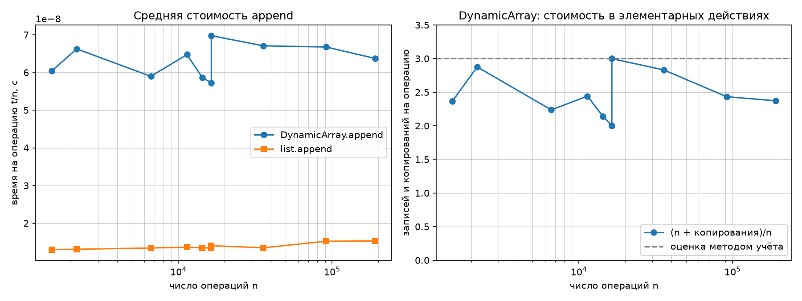
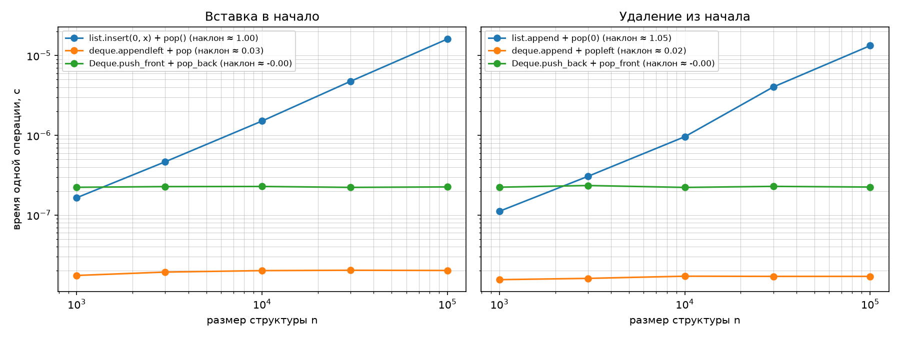

# Лабораторная работа 2 «Реализация рекурсивных функций и динамического массива, стека и дека».

## Цель работы

Освоить рекурсию как метод построения алгоритмов и реализовать базовые линейные структуры данных, подтвердив их асимптотические свойства (включая амортизированную сложность) экспериментально.

---

# Задание

## 1. Сгенерировать данные своего варианта: `python scripts/generate_data.py --variant N --only ops` — по 10⁵ операций над стеком и деком (структуры многократно опустошаются, встречаются операции над пустой структурой) и размеры серий `append`. Данные детерминированы: seed = 30 + N.

**Вариант:** 4, seed: 34

Данные были сгенерированы командой:
`python3 scripts/generate_data.py --variant 4 --only arrays`

---

## 2. Реализовать рекурсивные функции: факториал; числа Фибоначчи наивно и с мемоизацией — сравнить число вызовов счётчиком на нескольких n; Ханойские башни с подсчётом и записью перемещений, проверкой допустимости ходов и формулы 2^n − 1.

### 1. Факториал

Факториал вычисляется рекурсивно. Если `n` равно 0, функция возвращает 1, иначе вызывает себя для `n - 1`.

```python
def factorial(n: int) -> int:
    if n == 0:
        return 1
    return n * factorial(n - 1)
```

На каждом вызове `n` уменьшается на 1, поэтому функция выполняет линейное количество вызовов.

**Сложность:** O(n).

### 2. Числа Фибоначчи

В наивной реализации функция вызывает себя дважды: для `n - 1` и `n - 2`. Из-за этого одни и те же значения вычисляются повторно.

```python
def fib_naive(n: int) -> int:
    CALLS["fib_naive"] += 1
    if n == 0:
        return 0
    if n == 1:
        return 1
    return fib_naive(n - 1) + fib_naive(n - 2)
```

Мемоизация позволяет сохранять уже вычисленные значения последовательности. Если значение для аргумента уже находится в словаре, повторное вычисление не требуется.

При таком подходе каждое новое значение вычисляется один раз, а остальные обращения используют сохранённый результат.

```python
def fib_memo(n: int, memo: dict[int, int] | None = None) -> int:
    CALLS["fib_memo"] += 1
        if memo is None:
        memo = {}
    if n in memo:
        return memo[n]
    if n < 2:
        return n
    memo[n] = fib_memo(n - 1, memo) + fib_memo(n - 2, memo)
    return memo[n]
```

**Сложность:** наивная версия — O(2ⁿ), версия с мемоизацией — O(n).

### Сравнение числа вызовов

Результаты запуска программы для варианта 4:

| n | F(n) | Наивная рекурсия | С мемоизацией |
|---:|---:|---:|---:|
| 5 | 5 | 15 | 9 |
| 10 | 55 | 177 | 19 |
| 15 | 610 | 1 973 | 29 |
| 20 | 6 765 | 21 891 | 39 |
| 25 | 75 025 | 242 785 | 49 |
| 30 | 832 040 | 2 692 537 | 59 |

По результатам эксперимента видно, что с увеличением `n` число вызовов наивной рекурсии быстро растёт. Для `n = 30` она выполняет 2 692 537 вызовов, тогда как реализация с мемоизацией — только 59.

Следовательно, мемоизация существенно сокращает количество повторных вычислений и позволяет вычислять большие значения последовательности Фибоначчи значительно эффективнее.

Счётчик в программе учитывает все входы в функцию, включая обращения к уже сохранённым значениям. Поэтому число вызовов с мемоизацией не равно количеству уникальных вычислений.

### 3. Ханойские башни

Задача Ханойских башен состоит в переносе стопки дисков с одного стержня на другой с использованием вспомогательного стержня.

Для решения задачи сначала переносятся n дисков со src на dst, то есть перенести n-1 дисков со src на aux, перенести самый большой диск src → dst - один ход, записывается в moves между вычислением left и right, чтобы сохранить правильный временной порядок, перенести n-1 дисков с aux на dst.

```python
def hanoi(n: int, src: str = "A", dst: str = "C", aux: str = "B",
          moves: list[tuple[str, str]] | None = None) -> int:
    if n == 0:
        return 0
    left = hanoi(n - 1, src, aux, dst, moves)
    if moves is not None:
        moves.append((src, dst))
    right = hanoi(n - 1, aux, dst, src, moves)
    return left + 1 + right
```

При выполнении перемещений соблюдаются правила:

- за один ход перемещается только один диск;
- запрещено класть диск большего размера на диск меньшего размера;
- используется вспомогательный стержень.

Для решения задачи используется рекурсивный алгоритм. Сначала перемещаются `n - 1` дисков на вспомогательный стержень, затем самый большой диск переносится на целевой стержень, после чего оставшиеся диски переносятся на него.

Количество перемещений определяется формулой:

T(n)=2T(n-1)+1

При базовом условии `T(0) = 0` получаем:

T(n) = 2ⁿ - 1

self_check не только сверяет число ходов с формулой 2ⁿ-1, но и проигрывает записанные ходы на трёх виртуальных стержнях, проверяя, что больший диск ни разу не кладётся на меньший и что все диски в итоге оказываются на dst - то есть корректность решения проверяется не только по числу, но и по факту.

**Сложность:** O(2ⁿ).

---

## 3. Реализовать класс `DynamicArray` с ручным управлением ёмкостью (рост ×2): `append`, `pop`, `get`/`set`, `len` и счётчик копирований `copies`. Сжатие буфера в `pop` необязательно; если оно реализовано — вдвое при заполнении не более чем на ¼. Замерить среднюю стоимость `append` на размерах серий своего варианта для демонстрации амортизированной O(1).

### Реализация DynamicArray

Инвариант: 0 ≤ size ≤ capacity. При size == capacity перед записью вызывается _grow(): новый буфер удвоенной ёмкости, копирование size элементов, увеличение счётчика copies на число перенесённых элементов.

Массив хранит элементы во внутреннем буфере. Когда свободное место заканчивается, ёмкость увеличивается в два раза, а существующие элементы копируются в новый буфер.

```python
    def _grow(self) -> None:
        new_capacity = 2 * self._capacity
        new_buffer = [None] * new_capacity
        for i in range(self._size):
            new_buffer[i] = self._buffer[i]
        self.copies += self._size
        self._buffer = new_buffer
        self._capacity = new_capacity

    def append(self, value) -> None:
        if self._size == self._capacity:
            self._grow()
        self._buffer[self._size] = value
        self._size += 1

    def pop(self):
        if self._size == 0:
            raise IndexError("pop из пустого DynamicArray")
        self._size -= 1
        value = self._buffer[self._size]
        self._buffer[self._size] = None
        return value

    def get(self, index: int):
        if not 0 <= index < self._size:
            raise IndexError(f"индекс {index} вне диапазона [0, {self._size})")
        return self._buffer[index]

    def set(self, index: int, value) -> None:
        if not 0 <= index < self._size:
            raise IndexError(f"индекс {index} вне диапазона [0, {self._size})")
        self._buffer[index] = value
```
pop() уменьшает size и возвращает последний элемент, ячейка буфера очищается в None, чтобы не удерживать ссылку на удалённый объект.

### Амортизированный анализ

Метод учёта: каждой операции append назначается фиксированная амортизированная цена c, часть которой тратится сразу, а остаток откладывается как кредит на будущее копирование при росте буфера. Если кредита всегда хватает на оплату _grow() и он не становится отрицательным - суммарная стоимость n операций не превышает c·n, то есть амортизированная стоимость одной операции - O(1).

Пример цены: 3 условных единицы за каждый append.
-	1 единица - тратится сразу на запись элемента (self._buffer[size] = value);
-	2 единицы - откладываются как кредит, привязанный к этому элементу.

При росте буфера с capacity до 2·capacity копируются все capacity элементов (буфер был заполнен полностью непосредственно перед ростом). Ровно половина этих элементов (capacity/2) - те, что добавлены после предыдущего роста, и их кредит (2 единицы каждый) ещё не потрачен. Суммарный накопленный кредит: 2·(capacity/2) = capacity единиц - ровно столько, сколько стоит скопировать capacity элементов. Кредита хватает точно.

Поэтому суммарная работа для `n` добавлений составляет O(n), а средняя стоимость одного добавления — O(1).

**Амортизированная сложность `append` -** O(1).

### Результаты измерений

| Размер n | Время на `append`, с | Копирований | `(n + copies) / n` |
|---:|---:|---:|---:|
| 1 500 | 6.04 × 10⁻⁸ | 2 044 | 2.363 |
| 2 182 | 6.62 × 10⁻⁸ | 4 092 | 2.875 |
| 6 621 | 5.90 × 10⁻⁸ | 8 188 | 2.237 |
| 11 365 | 6.47 × 10⁻⁸ | 16 380 | 2.441 |
| 14 336 | 5.86 × 10⁻⁸ | 16 380 | 2.143 |
| 16 384 | 5.73 × 10⁻⁸ | 16 380 | 2.000 |
| 16 385 | 6.97 × 10⁻⁸ | 32 764 | 3.000 |
| 35 811 | 6.71 × 10⁻⁸ | 65 532 | 2.830 |
| 91 482 | 6.67 × 10⁻⁸ | 131 068 | 2.433 |
| 191 048 | 6.37 × 10⁻⁸ | 262 140 | 2.372 |

### График стоимости `append`



*Рисунок 1 — Средняя стоимость добавления элемента в собственный динамический массив и встроенный список Python.*

По результатам измерений среднее время `append` у собственного динамического массива остаётся примерно постоянным при увеличении размера входных данных. Наблюдаются небольшие колебания, связанные с особенностями выполнения Python и работой памяти.

При переходе через границу ёмкости число копирований увеличивается. Например, при `n = 16 384` число копирований составляет 16 380, а при `n = 16 385` — уже 32 764. Это связано с расширением буфера в два раза и копированием накопленных элементов.

---

## 4. Реализовать `Stack` и `Deque` на базе собственных структур (стек — на `DynamicArray` только через его публичный интерфейс, дек — на двусвязном списке).

### Стек

Стек реализован на основе `DynamicArray`.

Стек работает по принципу **LIFO (Last In, First Out)**: последним добавленный элемент извлекается первым.

Основные операции:

- `push()` — добавить элемент на вершину;
- `pop()` — извлечь элемент с вершины;
- `peek()` — получить верхний элемент без удаления.

При попытке получить элемент из пустого стека должна возникать ошибка.

```python
    def push(self, value) -> None:
        self._data.append(value)

    def pop(self):
        return self._data.pop()

    def peek(self):
        if len(self._data) == 0:
            raise IndexError("peek у пустого стека")
        return self._data.get(len(self._data) - 1)
```

Добавление элемента выполняется в конец динамического массива. Извлечение также происходит с конца, поэтому обе операции имеют амортизированную сложность O(1).

### Дек

Дек реализован на основе двусвязного списка. Каждый узел содержит значение, ссылку на предыдущий узел и ссылку на следующий узел.

Дек позволяет добавлять и удалять элементы с обоих концов.

Основные операции:

- `push_front()` — добавить элемент в начало;
- `push_back()` — добавить элемент в конец;
- `pop_front()` — удалить элемент из начала;
- `pop_back()` — удалить элемент с конца.

```python
    def push_front(self, value) -> None:
        node = _Node(value, prev=None, next=self._head)
        if self._head is not None:
            self._head.prev = node
        else:
            self._tail = node
        self._head = node
        self._size += 1

    def push_back(self, value) -> None:
        node = _Node(value, prev=self._tail, next=None)
        if self._tail is not None:
            self._tail.next = node
        else:
            self._head = node
        self._tail = node
        self._size += 1

    def pop_front(self):
        if self._head is None:
            raise IndexError("pop_front из пустого дека")
        node = self._head
        self._head = node.next
        if self._head is not None:
            self._head.prev = None
        else:
            self._tail = None
        self._size -= 1
        return node.value

    def pop_back(self):
        if self._tail is None:
            raise IndexError("pop_back из пустого дека")
        node = self._tail
        self._tail = node.prev
        if self._tail is not None:
            self._tail.next = None
        else:
            self._head = None
        self._size -= 1
        return node.value
```

При работе с двусвязным списком ссылки на начало и конец обновляются при каждой операции. Когда последний элемент удаляется, обе ссылки должны указывать на пустую структуру.

Операции добавления и удаления на концах дека выполняются за O(1), поскольку не требуют перемещения остальных элементов.

---

## 5. Сравнить свои структуры с `list` и `collections.deque`: вставку в начало (`list.insert(0, x)`, `deque.appendleft`, `Deque.push_front`) и удаление из начала (`list.pop(0)`, `deque.popleft`, `Deque.pop_front`) при размерах до 10⁵, а также время выполнения операций своего варианта. Объяснить, почему операции у начала `list` стоят O(n), а у `deque` и своего дека — O(1).

### Результаты эксперимента

### Вставка в начало

| Размер n | `list.insert`, с | `deque.appendleft`, с | Собственный `Deque.push_front`, с |
|---:|---:|---:|---:|
| 1 000 | 1.65 × 10⁻⁷ | 1.75 × 10⁻⁸ | 2.23 × 10⁻⁷ |
| 3 000 | 4.66 × 10⁻⁷ | 1.93 × 10⁻⁸ | 2.28 × 10⁻⁷ |
| 10 000 | 1.51 × 10⁻⁶ | 2.01 × 10⁻⁸ | 2.28 × 10⁻⁷ |
| 30 000 | 4.76 × 10⁻⁶ | 2.03 × 10⁻⁸ | 2.23 × 10⁻⁷ |
| 100 000 | 1.61 × 10⁻⁵ | 2.02 × 10⁻⁸ | 2.26 × 10⁻⁷ |

### Удаление из начала

| Размер n | `list.pop(0)`, с | `deque.popleft`, с | Собственный `Deque.pop_front`, с |
|---:|---:|---:|---:|
| 1 000 | 1.12 × 10⁻⁷ | 1.55 × 10⁻⁸ | 2.24 × 10⁻⁷ |
| 3 000 | 3.06 × 10⁻⁷ | 1.61 × 10⁻⁸ | 2.35 × 10⁻⁷ |
| 10 000 | 9.61 × 10⁻⁷ | 1.71 × 10⁻⁸ | 2.22 × 10⁻⁷ |
| 30 000 | 4.04 × 10⁻⁶ | 1.70 × 10⁻⁸ | 2.29 × 10⁻⁷ |
| 100 000 | 1.33 × 10⁻⁵ | 1.70 × 10⁻⁸ | 2.25 × 10⁻⁷ |



*Рисунок 2 — Сравнение времени вставки и удаления в начале списка и дека.*

Для встроенного списка Python вставка и удаление в начале имеют сложность O(n). После вставки или удаления элемента остальные элементы необходимо сдвинуть, чтобы сохранить непрерывное расположение элементов.

У `collections.deque` операции добавления и удаления на концах выполняются за O(1). Встроенный дек организован так, чтобы не перемещать все элементы при каждом изменении начала структуры.

Собственный `Deque` также демонстрирует постоянное время выполнения операций на концах. Для вставки и удаления достаточно изменить несколько ссылок между узлами.

При этом собственный дек медленнее встроенного `collections.deque`. В моём эксперименте вставка и удаление в начале собственного дека занимают примерно 0.22–0.24 микросекунды на операцию, тогда как у встроенного дека — около 0.02 микросекунды.

Разница объясняется тем, что встроенная реализация оптимизирована на уровне C, а собственная структура выполняет операции с объектами Python и обновляет ссылки на узлы.

### Операции на данных своего варианта

| Набор операций | Собственная структура, с/операцию | Эталон, с/операцию | Разница |
|---|---:|---:|---:|
| `ops_stack.txt` | 8.99 × 10⁻⁸ | 2.64 × 10⁻⁸ | в 3.4 раза медленнее |
| `ops_deque.txt` | 1.50 × 10⁻⁷ | 2.94 × 10⁻⁸ | в 5.1 раза медленнее |

Собственные структуры выполняют операции медленнее встроенных реализаций, но позволяют изучить устройство и стоимость основных операций. Встроенные структуры оптимизированы и используют более эффективные низкоуровневые реализации.

---

## 6. Зафиксировать инварианты (`size <= capacity`, рост ёмкости ×2, порядок LIFO/FIFO) и проверить реализации на репрезентативных тестах (пустая структура, один элемент, опустошение и повторное наполнение, серия операций через границу роста ёмкости) и сверкой с эталоном на операциях своего варианта. Все разделы `self_check` заготовки должны проходить; собственные проверки оформляются явными исключениями, а не `assert`, который отключается при запуске `python -O`.

Для проверки запускается функция `self_check()`. Она проверяет рекурсивные функции, динамический массив, стек, дек и операции варианта.

Три дополнительные проверки, написанные сверх тех, что уже были в заготовке:

-	Stack, будучи «обёрткой» над DynamicArray, всё равно ведёт себя внутри как настоящий динамический массив - его внутренняя ёмкость растёт по той же формуле ×2.
-	Счётчик copies никогда не уменьшается.
- Если вставлять элементы с обоих концов дека вперемешку (не просто «добавили и сразу убрали с того же конца»), итоговый порядок элементов всё равно остаётся правильным.

### Итог

self_check: OK  все шесть блоков отработали без ошибок.

---

## Вывод

В ходе лабораторной работы реализованы рекурсивные функции, динамический массив, стек и дек. Проверки `self_check` для варианта 4 завершились успешно. Эксперименты показали, что мемоизация значительно сокращает число вызовов Fibonacci, амортизированная стоимость `append` остаётся O(1), а операции в начале списка `list` растут линейно, в отличие от операций на концах дека.
